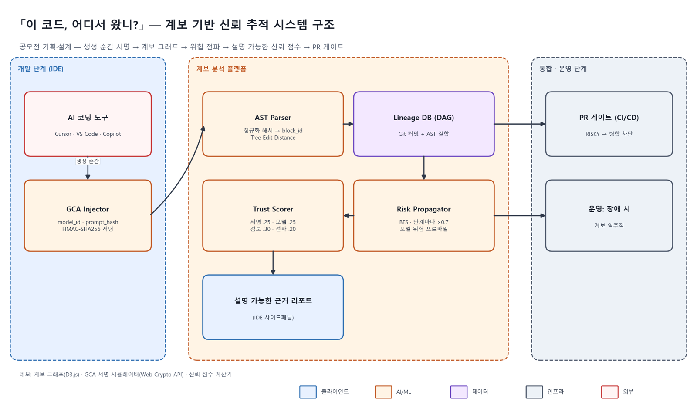

# 🔎 이 코드, 어디서 왔니?

**AI 생성 코드의 계보 기반 신뢰 추적 시스템**

바이브 코딩 AI 개선 아이디어 공모전 출품작 · 팀 제일코딩 · 2026

---

## 어떤 문제를 다루나요?

바이브 코딩으로 코드를 만드는 속도는 빨라졌지만, **이 코드가 어디서 왔는지, 왜 이렇게 작성됐는지, 믿어도 되는지**에 대한 기록은 남지 않습니다. Git과 정적 분석 도구는 코드의 **현재 상태(Snapshot)** 만 보고, 코드가 태어나고 바뀌고 퍼져 나간 **생애 주기(Lineage)** 는 보지 못합니다.

> 신뢰의 근거는 '이해'에서 **'검증과 추적'** 으로 옮겨가야 합니다.

## 제안 아이디어

| 영역 | 아이디어 | 핵심 기술 |
|:----:|------|------|
| 기술 | **생성 맥락 서명(GCA)** — 생성 순간 모델·프롬프트 해시·시각을 코드 블록에 서명 | AST 정규화 해시 + HMAC-SHA256 |
| 프로세스 | **세션 단위 계보 추적** — AI와의 대화 세션을 추적 단위로 | 세션 그래프 |
| 운영 | **위험 전파 경로 분석** — 취약 블록에서 의존 블록으로 위험이 퍼지는 경로 | DAG 탐색, 단계마다 ×0.7 감쇠 |
| 검증 | **설명 가능한 신뢰 점수** — 숫자와 근거를 함께 | 서명 25% · 모델 25% · 사람 검토 30% · 전파 위험 20% |

## 시스템 구조 (제안)

## 데모

아이디어의 핵심을 직접 만져볼 수 있게 브라우저에서 동작하는 데모 3종을 만들었습니다.

| 계보 그래프 (D3.js) | 신뢰 점수 계산기 |
|:---:|:---:|
|  |  |

GCA 서명 시뮬레이터는 Web Crypto API로 실제 SHA-256·HMAC 연산을 수행합니다.

## 레포지토리

| 레포 | 설명 |
|:----:|------|
| [vibe-coding-improvement](https://github.com/vibe-coding-research/vibe-coding-improvement) | 문서 5종(문제 정의 → 원인 분석 → 개선 아이디어 → 적용 시나리오 → 한계와 확장) · 데모 코드 |

## 팀 (제일코딩)

| 이름 | GitHub |
|:---:|:---:|
| 이성진 | [@FAITRUEE](https://github.com/FAITRUEE) |
| 류승래 | [@ryu2293](https://github.com/ryu2293) |

---

코드를 더 빠르게 만드는 도구가 아닌, 코드의 뿌리를 거슬러 올라갈 수 있는 추적 체계

